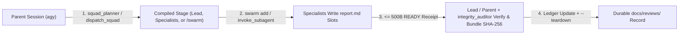

# Concepts and terminology

This guide defines the core terms used across Agy-Squad's CLI, MCP tools, skills, and architecture decision ledger.

## Execution lifecycle

### Role separation and dual-verdict gate

Agy-Squad splits content evaluation from execution-integrity auditing. The squad lead (or parent session) inspects cited source files and test runs to issue `Content Verdict: PASS`, `FAIL`, or `BLOCKED` on `lead/report.md`. Separately, an independent flat `integrity_auditor` queries worker transcripts in batch (`summaryOnly=true` / `lastTurns=10`) to issue `Integrity Verdict: CLEAN` or `INTEGRITY VIOLATION`. `node bin/agy-squad.mjs bundle` requires both verdicts before writing `lead/report.sources.json` (unless `--allow-unaudited` is passed). For the single canonical map of every role across all four skills, see [Roles, skill workflows, and runtime closure](roles-and-workflows.md).

## Core orchestration terms

### Parent session
The top-level Antigravity conversation (started via native `/swarm` or in **Antigravity Desktop (IDE)**; legacy `node bin/agy-squad.mjs run` was retired in Phase 2 per `L17` and `L42`). The parent session owns user approvals, invokes `squad_planner`, `dispatch_squad`, or native `swarm`, receives `<= 500` byte completion receipts, and makes the final acceptance decision.

### Shared swarm board and channel limits
Antigravity attaches one persistent board to each parent conversation (`board: "local"`). Every `swarm{action: "add"}` call, `post_message`, and retired (`killed: true`) member appends sequentially to that conversation's board history. Running multiple `/swarm` cohorts in the same chat accumulates all prior posts and retired workers in one UI payload, which slows down the Swarm UI pane on open.

- **Channels are host-gated, not user-configurable:** Antigravity's built-in `native_swarm` skill documents `swarm{action: "channel"}` conditionally (*"When the `swarm` tool offers the `channel` action..."*). When the host's `swarm` schema exposes only `status`, `models`, `add`, `model`, `kill`, and `title` (`post_message` accepts only `text`, and `read_board` has no `channel` filter), channels are disabled by the host runtime. Neither Antigravity settings nor Agy-Squad config can enable `channel` or `channels`.
- **Channels partition wakeups, not board databases:** Even on hosts that expose `channel`, `main` remains shared by all members, archived channel history stays readable, and retired workers remain in conversation history.
- **How to keep boards fast:** Start a fresh Antigravity conversation per major `/swarm` wave when you want a clean Swarm UI board (`#1`), or run repeated follow-up cohorts through `invoke_subagent` (`pr-review` / `self-diagnosis`), which does not append to the `/swarm` board. See [Stopping agents](stopping-agents.md) and [Native enforcement ledger (`NE-07`, `NE-11`)](plans/native-enforcement-ledger.md).

### Squad lead
An intermediate subagent compiled when `dispatch_squad` (`agy-squad dispatch`) runs with `squadId: "all_l1"` on a manifest defining one or more squads (or a `/swarm` lead in `Layered` mode). Each squad lead inspects its specialists' cited files, writes `scratch/agy-squad/.../lead/report.md` (`Content Verdict: PASS`, `FAIL`, or `BLOCKED`; bare `Verdict:` is accepted only as a legacy alias), pairs with an independent flat integrity auditor (`audit-<id>` on `/swarm`, `integrity_auditor` via slot; emits `Integrity Verdict: CLEAN` or `INTEGRITY VIOLATION`), and bundles SHA-256 digests via `node bin/agy-squad.mjs bundle`.

### Specialist
A focused worker compiled for a single squad (`squadId: "<id>"`). Under `invoke_subagent`, `dispatch_squad` compiles every specialist with `TypeName: "self"` and `Workspace: "inherit"` so it can inspect its assigned `scopeFiles` and write its evidence report to `scratch/agy-squad/.../specialist-<N>/report.md`. Under `/swarm`, `squad_planner` supports `workspaceIsolation` (`inherit`, `share`, or `branch`) while mapping worker report slots under `scratch/agy-squad/` (or custom `reportRoot`).

### Stage (`all_l1` vs. `<squadId>`)
A single compilation step returned by `dispatch_squad` (`agy-squad dispatch`) for `invoke_subagent` (in `squad_planner` / `agy-squad plan`, omit `squadId` to compile all squads; `all_l1` is not used in `squad_planner`):

- **Direct specialist stage (`squadId: "<id>"` or `"all_specialists"`):** Returns the `Subagents` array for that squad (or all manifest specialists reporting directly to the caller).
- **Lead stage (`squadId: "all_l1"`):** Returns one lead subagent per squad defined in the manifest (`1` or more squads).

### Manifest
A JSON file inside the workspace that defines `squads`, each containing an optional `lead` and a required `specialists` array (`role`, `objective`, `scopeFiles`, and optional `instructions`, `expectedDeliverable`, or `model`). When no explicit manifest path is given, `dispatch_squad` searches in order for `task-01-manifest.json`, `swarm-manifest.json`, `.scratch/swarm-manifest.json`, and `suite-manifest.json`. See [Manifest and tool contract](tools.md).

### Report slot
The deterministic workspace-relative path assigned to each specialist (`scratch/agy-squad/.../specialist-<N>/report.md`) or lead (`scratch/agy-squad/.../lead/report.md`). Writing full evidence to report slots keeps large markdown payloads out of the parent conversation context.

### Pointer-Over-Wire receipt (`<= 500` UTF-8 bytes)
The single-line message a child sends back to its parent when it finishes (`send_message` for `invoke_subagent`, or `post_message` for `/swarm`):

- `READY <report-path> — <concrete observation>`
- `PARTIAL <report-path> — <reason>`
- `NO_REPORT — <reason>`

`mcp/handoffs.mjs` enforces the `500` UTF-8 byte ceiling and single-line format.

### Evidence bundle (`report.sources.json`)
A JSON manifest written by `node bin/agy-squad.mjs bundle` alongside `lead/report.md`. It records the SHA-256 digest and byte size of `lead/report.md`, every `specialist-<N>/report.md`, any `integrityAudit` report (`path`, `sha256`, `verdict: "CLEAN"`, `targetSquad`), and every workspace file listed in `verifiedFiles`. Running `node bin/agy-squad.mjs verify` confirms that none of those files (including the integrity audit report on disk) changed or disappeared after bundling.

## Companion and governance terms

### Reactive Wakeup
Antigravity's event-driven resumption mechanism: when a background task or subagent calls `send_message` (or finishes), or a `/swarm` worker posts an `@mention`, the parent agent wakes automatically without polling `manage_task(Action='status')` in a loop.

### RTK (`Rust Token Killer`)
The command-line companion binary (`v0.51.0`) provisioned by `Agy-Context-Saver` (`v1.8.1+`). During live subagent sessions, `Agy-Context-Saver` routes workspace file reads and shell commands through `rtk read`, `rtk rg`, and `rtk find` to keep child transcripts compact.

### Self-diagnosis (`/self-diagnosis`)
Agy-Squad's harness diagnostic and optimization skill (`.agents/skills/self-diagnosis/SKILL.md`). It provides a zero-subagent local profiler (`diagnose.mjs`) and three targeted specialist cohorts that audit skills, runtime contracts, and token budgets under operator supervision.

### PR Review Standard `v1.3.0` (`/pr-review`)
The repository's review specification (`.agents/skills/pr-review/SKILL.md` and `.agents/skills/pr-review/references/pr-review-standard.md`). It requires commit and session provenance, architecture-before-runtime tracing, coverage across ten categories (`ARCH`, `DOC`, `SKILL`, `MCP`, `RUN`, `SVC`, `DB`, `SCRIPT`, `TEST`, `DEP`), and `1 ID = 1 Row` finding records in `docs/reviews/`.

### Decision ledger codes (`L1` through `L43`)
Short identifiers referencing architectural decisions in [`docs/plans/LEDGER.md`](plans/LEDGER.md):

- **Active architecture (`L1-L7, L21, L29-L31, L40-L43`):** Define host-enforced boundaries, the 500-byte receipt ceiling, and SHA-256 bundling (`L1, L2`), native stop controls (`L3, L5`), scratch isolation (`L4`), transcript boundaries (`L6`), zero real subagents in automated tests (`L7`), deny-by-default permissions (`L21, L40`), private distribution (`L29`), Zensical docs (`L30`), `Agy-Context-Saver` separation with `dispatch_squad` and `squad_planner` (`L31`), deterministic scratch teardown (`L41`), native `/swarm` governance and the SHA-256 verification CLI (`L42`), and `squad_planner` explicit model pinning, writable `scopeFiles` overlap detection, and `L6`-safe provenance scaffolding (`L43`).
- **Retired historical IDs (`L8-L12, L16, L17, L18-L20, L22-L24, L28, L35-L39`):** Record earlier Windows/Docker trials, the retired `agy-squad run` CLI PTY launcher (`L17`), and migration steps kept in [`docs/plans/LEDGER.md`](plans/LEDGER.md) for provenance.
