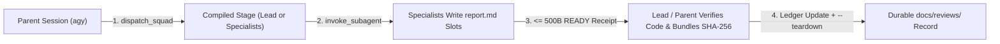

# Concepts and terminology

This guide defines the core terms used across Agy-Squad's CLI launcher, MCP tools, skills, and architecture decision ledger.

## Execution lifecycle

## Core orchestration terms

### Parent session
The top-level Antigravity conversation (started in **Antigravity Desktop (IDE)** or via `node bin/agy-squad.mjs run` in the CLI on POSIX / WSL2) that owns user approvals, invokes `dispatch_squad`, receives `<= 500` byte completion receipts, and makes the final acceptance decision.

### Squad lead
An intermediate subagent compiled when `dispatch_squad` runs with `squadId: "all_l1"` on a multi-squad manifest. Each squad lead dispatches its own domain specialists, verifies their cited files, writes `scratch/agy-squad/.../lead/report.md` (`Verdict: PASS`, `FAIL`, or `BLOCKED`), and bundles SHA-256 digests via `node mcp/handoffs.mjs`.

### Specialist
A focused worker subagent compiled for a single squad (`squadId: "<id>"`). Every specialist uses `TypeName: "self"` and `Workspace: "inherit"` so it can inspect its assigned `scopeFiles` and write its evidence report to `scratch/agy-squad/.../specialist-<N>/report.md`.

### Stage (`all_l1` vs. `<squadId>`)
A single compilation step returned by `dispatch_squad`:

- **Direct specialist stage (`squadId: "<id>"`):** Returns the `Subagents` array for that squad (`1` to `N` specialists reporting directly to the caller).
- **Lead stage (`squadId: "all_l1"`):** Returns one lead subagent per squad defined in the manifest (`2` or more squads).

### Manifest (`run-plan.json`)
A JSON file inside the workspace that defines `squads`, each containing an optional `lead` and a required `specialists` array (`role`, `objective`, `scopeFiles`, and optional `instructions`, `expectedDeliverable`, or `model`). See [Manifest and tool contract](tools.md).

### Report slot
The deterministic workspace-relative path assigned to each specialist (`scratch/agy-squad/.../specialist-<N>/report.md`) or lead (`scratch/agy-squad/.../lead/report.md`). Keeping full evidence in report slots prevents large markdown payloads from bloating parent conversation context.

### Pointer-Over-Wire receipt (`<= 500` UTF-8 bytes)
The single-line message a child sends back to its parent via `send_message` when it finishes:

- `READY <report-path> - <concrete observation>`
- `PARTIAL <report-path> - <reason>`
- `NO_REPORT - <reason>`

`mcp/handoffs.mjs` enforces the `500` UTF-8 byte ceiling and single-line format.

### Evidence bundle (`report.sources.json`)
A JSON manifest written by `node mcp/handoffs.mjs bundle` alongside `lead/report.md`. It records the SHA-256 digest and byte size of `lead/report.md`, every `specialist-<N>/report.md`, and every workspace file passed via `--file`. Running `node mcp/handoffs.mjs verify` checks that none of those files have changed since bundling. Digest verification proves artifact consistency, while the lead or parent's code and test inspection verifies semantic correctness.

## Companion and governance terms

### Reactive Wakeup
Antigravity's native event-driven resumption mechanism: when a background task or subagent calls `send_message` (or finishes), the parent agent wakes up automatically without polling `manage_task(Action='status')` in a loop.

### RTK (`Rust Token Killer`)
The command-line companion binary (`v0.51.0`) provisioned by `Agy-Context-Saver` (`v1.8.1+`). During live subagent sessions, `Agy-Context-Saver` routes workspace file reads and shell commands through `rtk read`, `rtk rg`, and `rtk find` to keep child transcripts compact.

### Self-diagnosis (`/self-diagnosis`)
Agy-Squad's built-in harness diagnostic and optimization skill (`.agents/skills/self-diagnosis/SKILL.md`). It provides both a zero-subagent local profiler (`diagnose.mjs`) and three targeted specialist cohorts that audit skills, runtime contracts, and token budgets under operator supervision.

### PR Review Standard `v1.3.0` (`/pr-review`)
The repository's formal review specification (`.agents/skills/pr-review/SKILL.md` and `references/pr-review-standard.md`). It requires commit and session provenance, architecture-before-runtime tracing, coverage across ten categories (`ARCH`, `DOC`, `SKILL`, `MCP`, `RUN`, `SVC`, `DB`, `SCRIPT`, `TEST`, `DEP`), and `1 ID = 1 Row` finding records in `docs/reviews/`.

### Decision ledger codes (`L1` through `L41`)
Short identifiers referencing architectural decisions in [`docs/plans/LEDGER.md`](plans/LEDGER.md):

- **Active architecture (`L1-L7, L17, L21, L29-L31, L40, L41`):** Define the current CLI and Desktop orchestration model (`L1`, `L7`), 500-byte receipt ceiling (`L29`), file-backed specialist slots and SHA-256 bundles (`L30`), `Agy-Context-Saver` separation (`L31`), and ledger-gated teardown (`L40`, `L41`).
- **Retired historical IDs (`L8-L12, L16, L18-L20, L22-L24, L28, L35-L39`):** Record earlier Windows/Docker trials and migration steps retained in `docs/plans/LEDGER.md` for historical provenance.
