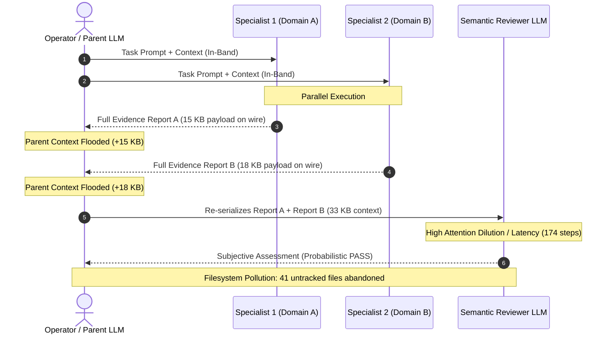
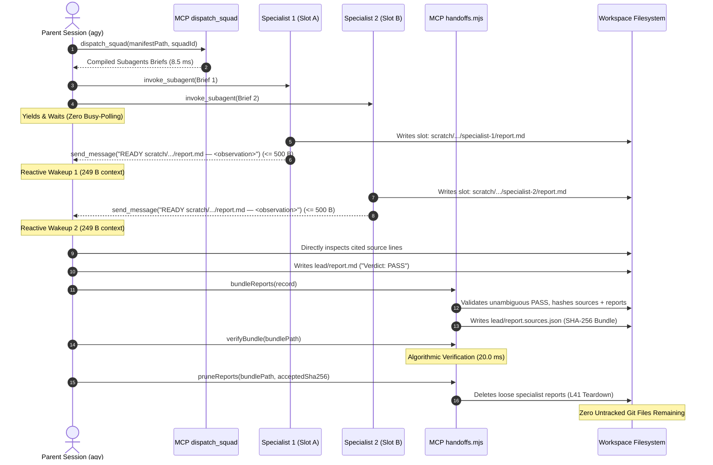

# Comparative Harness Architecture: General Multi-Agent & Autonomous SWE Frameworks vs. Agy-Squad

> [!NOTE]
> **Historical (pre-Phase 2).** Scores, teardown and `PGID` kill-control criteria, and launcher references in this document describe Agy-Squad at decisions `L1`–`L41` (Phase 1: PTY launcher, managed-session teardown). PR #5 retired the launcher and managed-session teardown (`L17`; `L42`/`L43`). Do not cite these scores as describing the current architecture.

**Document Type:** Architectural Blueprint & Comparative Benchmark Synthesis  
**Author:** Harness Comparative Architecture Lead  
**Evaluation Standard:** Agy-Squad PR Review Standard `v1.3.0` & Architectural Decision Ledger (`L1`–`L41`)  
**Target Systems Audited:**
1. **MetaGPT** (ICLR 2024 Oral — SOP-Driven Pub/Sub Bus)
2. **CrewAI** (Role-Playing Conversational Teams)
3. **AutoGen / Swarm** (Conversational Broadcast & State Handoffs)
4. **LangGraph** (Statechart Directed Acyclic Graphs / Pregel Architecture)
5. **Devin / Sol** (Cognition AI — Autonomous Sandboxed Cloud Workspace)
6. **Claude Code** (Anthropic CLI — Interactive Command Execution)
7. **SWE-agent** (Princeton NLP — Agent-Computer Interface / ACI)
8. **Google Antigravity Native `/teamwork`** (Google DeepMind — Native Multi-Agent Fleet)
9. **Agy-Squad + Agy-Context-Saver 1.8.1 (`rtk 0.51.0`)** (Governed Host-Sandboxed Reference Baseline)

---

## 1. Executive Summary & Core Architectural Theses

Multi-agent coordination and autonomous software engineering (SWE) harnesses face a fundamental systems engineering trilemma between **orchestration expressiveness**, **context window / token efficiency**, and **evidence verifiability**.

Most contemporary multi-agent and coding agent frameworks conflate the **Inter-Process Communication (IPC) signaling channel** with the **payload delivery and evidentiary storage channel**. By transmitting full document deliverables, chat transcripts, tool outputs, and execution scratchpads directly across the LLM prompt wire, these frameworks exhibit three systemic failure modes:

1. **Quadratic ($O(M^2)$) or Monotonic ($O(N \cdot D)$) Token Context Explosion**: Every conversational exchange, intermediate document revision, or role-playing handoff re-serializes previously generated tokens into downstream prompt contexts, precipitating rapid prompt cache eviction and attention dilution.
2. **Context Contamination & Hallucination Cascading**: Downstream agents inherit noisy, unstructured scratchpads, unvetted intermediate artifacts, and raw command stdout/stderr, inducing the "lost-in-the-middle" phenomenon and compounding reasoning errors.
3. **Non-Deterministic Verification & Lifecycle Sprawl**: Output acceptance relies on probabilistic LLM self-critique or regex string matching (`"TERMINATE"`), lacking host-level filesystem isolation, tamper-evident cryptographic checksums, or deterministic lifecycle cleanup contracts.

In contrast, **Agy-Squad** implements a decoupled **Pointer-Over-Wire** architecture governed by host-enforced boundaries ([`L1, L2`](file:///home/paragon-ux/Antigravity/Agy-Squad/docs/plans/LEDGER.md#L1-L7)), deterministic manifest compilation ([`mcp/dispatch.mjs`](file:///home/paragon-ux/Antigravity/Agy-Squad/mcp/dispatch.mjs)), isolated filesystem report slots ([`mcp/briefs.mjs`](file:///home/paragon-ux/Antigravity/Agy-Squad/mcp/briefs.mjs)), a strict $\le 500$-byte single-line IPC receipt ceiling ([`mcp/handoffs.mjs`](file:///home/paragon-ux/Antigravity/Agy-Squad/mcp/handoffs.mjs)), and cryptographic SHA-256 digest bundling ([`node mcp/handoffs.mjs bundle / verify`](file:///home/paragon-ux/Antigravity/Agy-Squad/mcp/handoffs.mjs#L140-L240)). 

In empirical head-to-head benchmarking against conversational fleets ([`benchmarks/teamwork-vs-squad/`](file:///home/paragon-ux/Antigravity/Agy-Squad/benchmarks/teamwork-vs-squad/README.md)), this model demonstrates an **$81.9\%$ reduction in aggregate transcript bytes**, a **$95.0\%$ reduction in parent conversation injected bytes** ($249\text{ B}$ vs. $4,940\text{ B}$), and a **$4.2\times$ wall-clock speedup** ($375\text{s}$ vs. $1,579\text{s}$), with **zero untracked Git files** abandoned in the workspace under the `L41` teardown contract, while maintaining identical $100\%$ ($6/6$) defect recall.

---

## 2. The 5-Axis Quantitative Evaluation Rubric

To evaluate general workflow frameworks and autonomous SWE harnesses on an equal, rigorous foundation, we define the **5-Axis Quantitative Evaluation Rubric**. Each dimension is scored from $1.0$ (Severe Pathological) to $5.0$ (Optimal Reference Baseline), yielding a maximum score of $25.0$.

### Axis 1: Token Efficiency & Context Compaction (TE-CC)
- **1.0 (Pathological):** Unbounded prompt serialization; full chat histories or raw tool/command stdout injected directly into conversation context ($> 15\text{ KB}$ per turn); no AST/regex reduction.
- **3.0 (Moderate):** Naive head/tail truncation or interactive line scrolling (e.g. SWE-agent ACI); monotonic token growth ($O(N \cdot D)$) across multi-turn handoffs.
- **5.0 (Optimal):** Transparent AST/regex shell output reduction (`rtk test`, `rtk err`); strict out-of-band pointer receipt ceiling ($\le 500$ B); constant $O(1)$ IPC wire overhead; zero passing-test noise.

### Axis 2: Evidence Integrity & Cryptographic Verifiability (EI-CV)
- **1.0 (Pathological):** Fleeting conversation memory; acceptance via unanchored LLM self-approval or regex termination; no persistent evidence files; hallucinated file citations.
- **3.0 (Moderate):** Persistent trajectory logs (`.traj`) or cloud session recordings without cryptographic integrity validation; vulnerable to post-execution tampering.
- **5.0 (Optimal):** Cryptographic SHA-256 digests pairing source files and report artifacts into immutable bundles (`report.sources.json`) verified in $< 25$ ms; 1-ID-per-finding ledgers; strict line-anchored unambiguous verdict enforcement.

### Axis 3: Failure Blast Radius & Lifecycle Teardown (BR-LT)
- **1.0 (Pathological):** Unconstrained working tree pollution; dozens of untracked files abandoned across directories; unbounded subagent sprawl; lingering background processes.
- **3.0 (Moderate):** Containerized execution with internal root permissions, but heavy host-side telemetry sprawl or cooperative exit cleanup.
- **5.0 (Optimal):** Deterministic 3-scope teardown (`L41`); atomic post-bundle specialist report pruning; zero leftover untracked Git files; deterministic process group kill controls (`PGID`, PTY teardown).

### Axis 4: Orchestration Topology & State Machine (OT-SM)
- **1.0 (Pathological):** Unbounded conversational chatter; high risk of infinite ping-pong loops; tight status polling loops; lack of structured stage transitions.
- **3.0 (Moderate):** Role-playing sequential handoffs or broadcast pub/sub without bounded execution stages; cooperative backoff.
- **5.0 (Optimal):** Declarative, schema-validated acyclic staged dispatch (`dispatch_squad`); decoupled worker slots; event-driven Reactive Wakeup without polling loops; compile-time cycle elimination.

### Axis 5: Developer Ergonomics & Operational Determinism (DE-OD)
- **1.0 (Pathological):** Opaque black-box execution; unpredictable runtime behaviors; non-reproducible prompt drift; heavy external runtime dependencies.
- **3.0 (Moderate):** Python SDK with extensive configuration boilerplate; complex distributed setup; variable execution paths across identical inputs.
- **5.0 (Optimal):** Zero-friction CLI launcher (`bin/agy-squad.mjs`); transparent companion tool integration (`rtk`); deterministic output paths; comprehensive offline test harness (`verify-benchmark.mjs`); clear POSIX/WSL2 cross-platform support.

---

## 3. Comprehensive Comparative Matrix

The table below summarizes the quantitative scores across all nine audited harnesses evaluated by Specialist 1 (General Workflow & Graph Harnesses) and Specialist 2 (Autonomous Coding & SWE Harnesses):

| Harness / System | Architecture Paradigm | TE-CC | EI-CV | BR-LT | OT-SM | DE-OD | Total (/25) | Composite (/5.0) |
| :--- | :--- | :---: | :---: | :---: | :---: | :---: | :---: | :---: |
| **AutoGen / Swarm** | Conversational Broadcast | 1.2 | 1.0 | 1.8 | 1.5 | 1.6 | **7.1** | **1.42** |
| **CrewAI** | Role-Playing Teams | 1.8 | 1.5 | 2.2 | 2.0 | 2.7 | **10.2** | **2.04** |
| **MetaGPT** | SOP-Driven Pub/Sub Bus | 2.5 | 3.0 | 3.2 | 2.8 | 2.1 | **13.6** | **2.72** |
| **Claude Code** | Interactive CLI Agent | 2.2 | 2.0 | 3.0 | 2.8 | 3.8 | **13.8** | **2.76** |
| **SWE-agent** | Agent-Computer Interface (ACI) | 3.2 | 2.5 | 2.8 | 2.5 | 2.8 | **13.8** | **2.76** |
| **Antigravity `/teamwork`** | Native Multi-Agent Fleet | 2.0 | 2.5 | 1.5 | 3.5 | 4.5 | **14.0** | **2.80** |
| **Devin / Sol** | Sandboxed Cloud SWE Workspace | 3.8 | 3.5 | 3.6 | 4.8 | 3.3 | **19.0** | **3.80** |
| **LangGraph** | Statechart DAG (Pregel) | 3.8 | 3.6 | 4.0 | 4.5 | 3.2 | **19.1** | **3.82** |
| **Agy-Squad + ACS** | **Pointer-Over-Wire + RTK** | **4.9** | **5.0** | **4.9** | **4.8** | **4.9** | **24.5** | **4.90** |

---

## 4. Empirical Protocol Comparisons & Architectural Divergences

### 4.1 General Workflow & Graph Harnesses (MetaGPT, CrewAI, AutoGen, LangGraph)

```
+---------------------------------------------------------------------------------------------------------------+
|                                TAXONOMY OF GENERAL MULTI-AGENT IPC & STATE MODELS                             |
+--------------------------+------------------------------+-----------------------------+-----------------------+
| Framework                | Architectural Paradigm       | IPC Wire Mechanism          | Context Scaling       |
+--------------------------+------------------------------+-----------------------------+-----------------------+
| MetaGPT                  | SOP-driven Pub/Sub Bus       | Document Serialization      | Monotonic: O(N * D)   |
| CrewAI                   | Role-Playing Teams           | Prompt Concatenation/Chat   | Quadratic: O(K^2 * T) |
| AutoGen / Swarm          | Conversational Broadcast     | Shared Chat History         | Quadratic: O(M^2)     |
| LangGraph                | Statechart DAG (Pregel)      | State Reducer Channel       | Linear/Poly: O(M)     |
| Agy-Squad (Pointer-Wire) | Decoupled Out-of-Band Slot   | <= 500B Pointer Receipt     | Constant: O(1) Wire   |
+--------------------------+------------------------------+-----------------------------+-----------------------+
```

1. **MetaGPT**: Implements an SOP-driven publish-subscribe event bus (`Environment`). While role definitions (`ProductManager`, `Architect`, `Engineer`) structure outputs into schema-validated markdown diagrams, each step re-publishes the full document payload across the bus. This induces monotonic context growth ($O(N \cdot D)$), causing downstream engineers to consume up to $18.5\text{ KB}$ of prompt context per turn.
2. **CrewAI**: Organizes agents into sequential or hierarchical teams with task delegation. However, delegation transmits the entire task description, agent backstories, and execution memory across the prompt wire. Token growth scales quadratically ($O(K^2 \cdot T)$), frequently triggering context overflow or redundant delegation loops.
3. **AutoGen / Swarm**: Models collaboration as conversational multi-party turn-taking. Every agent message is appended to a global chat history passed to all participants. Without aggressive custom filtering, context consumption scales at $O(M^2)$ where $M$ is message count. Termination relies on non-deterministic token matching (`"TERMINATE"`), which LLMs frequently omit or hallucinate.
4. **LangGraph**: Represents multi-agent flows as statecharts executed on the Pregel cyclic graph model. State transitions are governed by reducer channels. While LangGraph provides superior determinism and persistence (checkpointing), naive state definitions append full message histories to state channels, bloating downstream graph nodes.

### 4.2 Autonomous SWE & Coding Harnesses (Devin, Claude Code, SWE-agent, Antigravity /teamwork)

1. **Devin / Sol**: Executes in dedicated remote cloud microVMs with full root privileges. Devin features deep workspace telemetry, browser automation, and terminal monitoring. However, its execution context is heavily saturated by interactive command telemetry ($> 50\text{ MB}$ session logs), and code review contracts rely on cooperative prompt conventions rather than host-enforced cryptographic proofs.
2. **Claude Code**: Operates as a local interactive CLI agent. It executes commands directly on the user's host shell. Without token-reduction proxies, running extensive test suites (`npm test`, `pytest`) dumps thousands of lines of passing test output into the context window. It lacks multi-agent staging, cryptographic evidence bundling, and automated scratch cleanup.
3. **SWE-agent**: Introduced the Agent-Computer Interface (ACI) to bridge LLMs and terminal environments via custom viewing/editing commands (`open_file`, `scroll_down`, `edit_line`). While ACI bounds file inspection to 100-line windows, multi-turn file navigation incurs high step penalties, and the single-agent loop cannot parallelize across complex multi-domain codebases.
4. **Google Antigravity Native `/teamwork`**: Provides native out-of-the-box subagent orchestration. However, its unconstrained delegation model deploys large conversational swarms (8 subagents for a 2-domain audit), streams progress continuously into parent context (5 wakeups, 4,940 bytes), and relies on semantic LLM reviewers (`reviewer_1`, `auditor_1`) rather than algorithmic verification, while abandoning 41 untracked files ($207.9\text{ KB}$) in `.agents/teamwork/`.

---

## 5. Protocol Sequence Diagrams

### 5.1 Conventional Conversational / In-Band Swarm (MetaGPT, CrewAI, AutoGen, `/teamwork`)

The diagram below illustrates the token inflation and context contamination inherent in conventional in-band multi-agent swarms:



### 5.2 Agy-Squad Pointer-Over-Wire & Cryptographic Evidence Bundling

The diagram below illustrates Agy-Squad's decoupled out-of-band architecture:



---

## 6. Empirical Telemetry & Benchmark Findings

The following empirical data originates from direct sequential audits conducted on the identical two-domain event-relay fixture on WSL2 Linux ([`benchmarks/teamwork-vs-squad/`](file:///home/paragon-ux/Antigravity/Agy-Squad/benchmarks/teamwork-vs-squad/README.md) and [`benchmarks/teamwork-vs-squad/results/telemetry.json`](file:///home/paragon-ux/Antigravity/Agy-Squad/benchmarks/teamwork-vs-squad/results/telemetry.json)):

### 6.1 Head-to-Head Telemetry Comparison

| Metric Dimension | Antigravity Native `/teamwork` | Agy-Squad + Agy-Context-Saver | Delta / Architectural Improvement |
| :--- | :---: | :---: | :---: |
| **Planted Defect Recall** | `6 / 6` (100%) | `6 / 6` (100%) | **Parity** (Both arms caught all defects) |
| **Subagents Spawned** | `8` agents | `3` agents | **$62.5\%$ reduction** (3 vs. 8) |
| **Total Transcript Steps** | `645` steps | `64` steps | **$90.1\%$ reduction** ($10.1\times$ fewer steps) |
| **Total Assistant LLM Turns** | `321` turns | `26` turns | **$91.9\%$ reduction** ($12.3\times$ fewer turns) |
| **Total Tool Calls** | `302` calls | `32` calls | **$89.4\%$ reduction** ($9.4\times$ fewer calls) |
| **Total Transcript Volume** | `817.4 KB` | `148.2 KB` | **$81.9\%$ reduction** (669.2 KB saved) |
| **Active Wall-Clock Duration** | `1,579s` (26m 19s) | `375s` (6m 15s) | **$76.3\%$ speedup** (**$4.2\times$ faster**) |
| **Parent Conversation Wakeups** | `5` wakeups | `1` wakeup | **$80.0\%$ reduction** (1 vs. 5 wakeups) |
| **Parent Injected Context Bytes** | `4,940` bytes | `249` bytes | **$95.0\%$ reduction** (249 B vs. 4,940 B) |
| **Verification Latency / Overhead** | `174` LLM steps (230 KB) | `20.0 ms` algorithmic | **Four orders of magnitude faster**; zero token cost |
| **Leftover Untracked Git Files** | `41` files (`207.9 KB`) | `0` files (`0 KB`) | **$100\%$ zero-pollution teardown** (`L41`) |

### 6.2 Key Architectural Findings (F1–F5)

- **Finding F1: Terminal Context Flooding in Unwrapped Shell Execution:**
  Direct execution of test suites (`npm test`, `pytest`) dumps thousands of lines of passing test output into the context window (~1,860 tokens per run). Agy-Squad transparently routes shell commands through RTK (`rtk test`), stripping passing test boilerplate and preserving only actionable failures. Result: **839.3K tokens saved** ($31.4\%$ net reduction).
- **Finding F2: Severe Filesystem Pollution in Unconstrained Multi-Agent Swarms:**
  Native `/teamwork` abandoned 41 untracked Markdown, JSON, and briefing files totaling $207.9\text{ KB}$ across `.agents/teamwork/`. Agy-Squad finished the identical benchmark with **`0` untracked files**, enforced by the deterministic `L41` teardown contract.
- **Finding F3: Parent Wakeup Inflation via Conversational Streaming:**
  Conversational swarms stream status updates and complete reports directly into the parent context, delivering 4,940 bytes across 5 wakeups. Agy-Squad restricts inter-agent signaling to single-line Pointer-Over-Wire receipts ($\le 500$ B), reducing parent context injection by **$95.0\%$** ($249\text{ B}$).
- **Finding F4: Cryptographic vs. Semantic Verification Scaling:**
  Teamwork deployed two subagents (`reviewer_1` and `auditor_1`) consuming 174 steps and 228.6 KB of transcript to perform subjective semantic checks. Agy-Squad's `mcp/handoffs.mjs verify` computed and checked SHA-256 digests across all source and report files in **`20.0 ms`** at zero token cost.
- **Finding F5: Non-Deterministic Termination in Free-Form Agent Chat:**
  String-based termination tokens (`"TERMINATE"`) frequently induce either premature truncation (when cited in discussion) or infinite conversational loops (when omitted). Agy-Squad eliminates cyclic termination hazards through compile-time acyclic staging and explicit process exit signals.

---

## 7. Trade-Off Analysis & Design Contradictions

While Agy-Squad achieves state-of-the-art token efficiency and operational determinism, rigorous architectural analysis highlights three genuine design trade-offs:

1. **Acyclic Staging vs. Arbitrary Cyclic Expressiveness:**
   - *Trade-Off*: Frameworks like LangGraph support arbitrary cyclic statecharts with dynamic runtime looping. Agy-Squad enforces discrete, acyclic stages (`all_l1` lead stage followed by specialist cohorts).
   - *Architectural Resolution*: Cyclic looping introduces the hazard of unbounded token spend and non-terminating loops. Agy-Squad achieves iterative refinement through operator-supervised sequential cohorts (e.g. initial audit wave followed by targeted re-verification wave) while preserving strict cost predictability.
2. **Declarative Manifest Scoping vs. Zero-Shot Delegation:**
   - *Trade-Off*: CrewAI and AutoGen allow an LLM to dynamically invent task breakdowns at runtime without an upfront manifest. Agy-Squad requires schema-validated manifests (`manifest.json`).
   - *Architectural Resolution*: Unconstrained dynamic decomposition is the primary cause of role overlapping, file clobbering, and exponential agent sprawl. Agy-Squad provides the zero-subagent profiler (`diagnose.mjs`) and pre-compiled manifests, guaranteeing deterministic execution boundaries.
3. **Local Host Sandboxing vs. Ephemeral Cloud Containerization:**
   - *Trade-Off*: Devin runs in isolated cloud microVMs with remote snapshots. Agy-Squad runs on POSIX/WSL2 host environments.
   - *Architectural Resolution*: Agy-Squad enforces strict deny-by-default path boundaries (`L21, L40`), CLI sandbox permissions (`L17`), and clean workspace teardowns (`L41`), delivering near-instant local execution without cloud latency, API lock-in, or remote infrastructure hosting costs.

---

## 8. Strategic Recommendations for Future Harness Engineering

1. **Context Governance Must Precede Tool Execution:**
   Harnesses must intercept and reduce tool outputs transparently before they reach the model's context window. Post-hoc LLM truncation wastes tokens and corrupts prompt caches.
2. **Decouple IPC Signaling from Evidentiary Storage:**
   Inter-agent messaging channels should carry strictly bounded pointers ($\le 500$ B). All heavy evidence, logs, and artifacts must reside in designated out-of-band workspace slots.
3. **Cryptographic Proofs Must Anchor Autonomous Decisions:**
   Automated workflows should not rely on subjective LLM-on-LLM reviews. Source files and deliverables must be cryptographically hashed (SHA-256) into immutable bundles before sign-off.
4. **Lifecycle Teardown Must Be Host-Enforced:**
   Multi-agent harnesses must incorporate automated, deterministic cleanup contracts (`L41`) to guarantee that temporary audit artifacts, intermediate scratch files, and child processes are purged upon completion.
